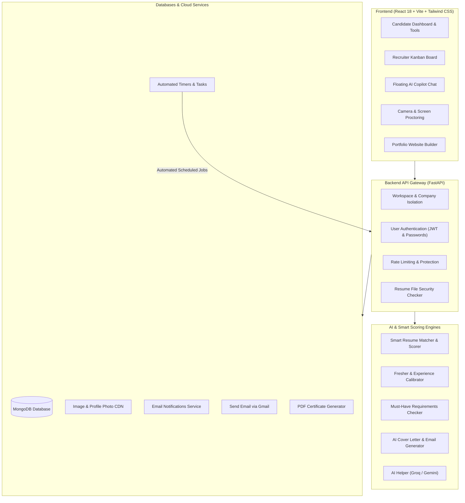

# 🚀 CareerShala — Smart AI Career Platform & Applicant Tracking System (ATS)

[](https://www.careershala.tech)
[](https://github.com/agrawalrohit937/Resume-Screening-System)
[](https://fastapi.tiangolo.com)
[](https://reactjs.org/)
[](https://vitejs.dev/)
[](https://www.mongodb.com/)
[](https://tailwindcss.com/)
[](https://opensource.org/licenses/MIT)
[](https://github.com/agrawalrohit937/Resume-Screening-System)

> [!IMPORTANT]
> 🌐 **Try it Live**: **[https://www.careershala.tech](https://www.careershala.tech)**  
> CareerShala is deployed live in production. You can explore resume ATS scoring, AI mock interviews with camera proctoring, recruiter Kanban pipelines, candidate portfolios, and the AI copilot without any local setup!

---

## 📌 Table of Contents
1. [What is CareerShala?](#-what-is-careershala)
2. [Why We Built This (The Problem It Solves)](#-why-we-built-this)
3. [Live Demo & Quick Links](#-live-demo--quick-links)
4. [Pre-Seeded Demo Accounts](#-pre-seeded-demo-accounts)
5. [System Architecture](#-system-architecture)
6. [Built-in Reliability & Automatic Fallbacks](#-built-in-reliability--automatic-fallbacks)
7. [Complete Features Walkthrough](#-complete-features-walkthrough)
   - [For Job Seekers (Candidates)](#a-for-job-seekers-candidates)
   - [For Recruiters & Hiring Teams](#b-for-recruiters--hiring-teams)
   - [Platform & System Features](#c-platform--system-features)
8. [Technology Stack](#-technology-stack)
9. [Project Directory Structure](#-project-directory-structure)
10. [Local Installation & Setup Guide](#-local-installation--setup-guide)
11. [Environment Variables Explained](#-environment-variables-explained-backendenv)
12. [Testing & Quality Benchmarks](#-testing--quality-benchmarks)
13. [Production Deployment Guide](#-production-deployment-guide)
14. [Contributing & License](#-contributing)
15. [Contact & Support](#-contact--support)

---

## 💡 What is CareerShala?

**CareerShala** is an all-in-one AI career ecosystem and modern Applicant Tracking System (ATS). It connects job seekers with hiring teams by solving two big challenges:

1. **For Job Seekers**: Most resumes get rejected by company ATS software before a human even reads them. CareerShala gives candidates clear, actionable feedback to fix their resume, lets them practice realistic AI mock interviews, and helps them build an online portfolio and job applications in minutes.
2. **For Recruiters**: Reviewing thousands of resumes manually takes days. CareerShala automatically reads and ranks resumes against job descriptions, filters out unqualified applicants fairly, and manages hiring stages in a visual Kanban board.

---

## 🎯 Why We Built This

| Traditional Job Search & Hiring | How CareerShala Fixes It |
| :--- | :--- |
| **Black-box ATS rejection**: Candidates never know why their resume was rejected. | **Clear feedback**: Explains exact missing skills, keyword gaps, and formatting issues. |
| **Freshers unfairly penalized**: Keyword tools often reject freshers simply because they have 0 years of experience. | **Smart experience calibration**: Grades freshers on projects and core skills rather than years of experience. |
| **Stressful, unprepared interviews**: Candidates don't get realistic practice before real job interviews. | **AI Mock Interviewer**: Interactive practice with dynamic follow-up questions and eye-contact monitoring. |
| **Slow, manual resume sorting**: HR teams spend 20+ hours reading resumes for a single job opening. | **Automated screening**: Instantly ranks candidates and checks must-have qualifications in seconds. |
| **Unconscious bias in hiring**: Personal demographics (gender, age, location) can affect candidate evaluation. | **Blind screening**: Hides personal background details during initial evaluation to keep hiring fair. |

---

## 🌟 Live Demo & Quick Links

- 🌐 **Live Web Application**: [https://www.careershala.tech](https://www.careershala.tech)
- ⚙️ **Interactive API Docs (Swagger)**: `http://localhost:8000/docs`
- 📚 **Alternative API Specs (ReDoc)**: `http://localhost:8000/redoc`
- 📜 **Certificate Verification**: [Verify Certificate](https://www.careershala.tech) (`/verify/:certificateId`)
- 💼 **Sample Candidate Portfolio**: [View Portfolio](https://www.careershala.tech) (`/portfolio/:username`)
- 🏢 **Company Careers Page**: [View Company Page](https://www.careershala.tech) (`/company/:companySlug`)

---

## 🔑 Pre-Seeded Demo Accounts

To test CareerShala locally without creating accounts manually, run `python scripts/seed_demo_data.py` inside `backend/` to unlock these pre-configured accounts:

| Role | Email | Password | What You Can Test |
| :--- | :--- | :--- | :--- |
| **Candidate** | `candidate@careershala.com` | `Candidate123!` | Resume ATS scoring, skill radar charts, AI mock interview, portfolio editor, job outreach |
| **Recruiter / HR** | `recruiter@careershala.com` | `Recruiter123!` | Create job requisitions, candidate Kanban board, candidate scorecards, hiring stages |
| **Platform Admin** | `admin@careershala.com` | `Admin123!` | System settings, user accounts, system health metrics, subscription plans |

> [!TIP]
> **Zero Configuration Friction**: The platform has built-in smart fallbacks. Even if you do not add paid external API keys (like Groq or Brevo), the app works smoothly using local templates and fallback heuristics.

---

## 📖 System Architecture

CareerShala is built as a modern, decoupled web application. The frontend runs in the browser using React, and communicates through a secure API with the FastAPI Python backend:



---

## 🛡️ Built-in Reliability & Automatic Fallbacks

In many web apps, if a third-party service (like an AI provider or email server) goes down, the entire app crashes. CareerShala implements a **2-Tier Fallback Strategy** so that every single feature keeps working:

| Subsystem | Primary Method | Automatic Fallback | Final Safety Net |
| :--- | :--- | :--- | :--- |
| **AI Responses (LLM)** | Primary Groq / Gemini API key | Automatically rotates through a pool of backup keys | Returns a curated local response template |
| **PDF Resume Reading** | Cloud OCR (Azure Document Intelligence) | Local `pdfplumber` layout-aware text extractor | Clean raw text extraction |
| **Resume Matching Score** | Local BGE-M3 Neural Embedding model | Google Gemini Cloud Vector Embeddings | Deterministic skill & keyword overlap calculation |
| **AI Output Parsing** | Standard `json.loads` | Auto-repairing `json-repair` tool (fixes markdown blocks) | Safe default response bank |
| **Task Synchronization** | MongoDB atomic document lock (`find_one_and_update`) | In-memory atomic lock | Aborts duplicate overlapping jobs safely |
| **Background Scheduling** | Azure Cloud Timer Triggers | Admin Webhook endpoints (`/admin/trigger-*`) | Built-in fallback task sweep |
| **Payment Activation** | Instant checkout verification | Background Razorpay webhook listener | Auto-checks status when user next logs in |

---

## ✨ Complete Features Walkthrough

### A. For Job Seekers (Candidates)

1. **Smart ATS Resume Scoring & Gap Analysis**:
   - Upload your resume in PDF or Word (`.docx`) format.
   - Compares your resume against any job description and gives a match score from 0% to 100%.
   - Breaks down your score into **Skills Match**, **Experience Level**, **Education**, and **Formatting**.
   - Displays a visual **Skills Radar Chart** showing your strengths and areas to improve.
   - Highlights exact missing keywords that you should consider adding.

2. **Fair Scoring for Freshers**:
   - Traditional ATS systems reject freshers because their years of experience are zero.
   - CareerShala automatically detects entry-level roles and evaluates freshers based on their projects, technical skills, coursework, and problem-solving abilities.

3. **Resume Cheat & Hack Detection**:
   - Detects sneaky tricks like invisible white text, 1pt micro-fonts, and impossible work dates.
   - Keeps candidates informed on whether their resume looks natural and professional.

4. **Real-Time AI Mock Interviews with Live Camera Proctoring**:
   - Choose a target job role and experience level.
   - The AI interviewer asks questions via voice and text, listens to your answers, and asks relevant follow-up questions.
   - **In-Browser Vision Proctoring** (runs 100% locally on your computer for privacy):
     - Monitors face position and eye gaze to encourage confident eye contact.
     - Alerts you if multiple people or a smartphone appear in front of the camera.
     - Tracks tab switching to prevent cheating.
     - Generates an **Interview Integrity Score (0–100%)** alongside a communication and technical evaluation report.

5. **1-Click Online Portfolio Builder**:
   - Automatically reads your resume and converts it into a ready-to-share online portfolio website.
   - Offers **6 visual themes**:
     - *Bento Grid* (Modern cards)
     - *Glassmorphic Pro* (Sleek frosted glass look)
     - *Cyberpunk Neon* (High-tech vibrant dark mode)
     - *Minimal Elegance* (Clean and simple typography)
     - *Terminal Developer* (Retro command-line style)
     - *3D Interactive* (Playful interactive elements)
   - Hosted with a shareable URL (`/portfolio/:username`) and an integrated contact form so recruiters can message you directly.

6. **AI Job Application Assistant**:
   - Take a screenshot of any job post on LinkedIn, Indeed, or any company site.
   - The system reads the image, extracts the job title, requirements, and recruiter email address.
   - Generates a customized cover letter and cold outreach email tailored to your resume.
   - Allows sending the email directly through your connected Gmail or Brevo account with one click.

7. **Tamper-Proof Skill Certificates**:
   - Complete mock interviews or skill challenges to earn a verified certificate.
   - Includes a unique alphanumeric Credential ID, a SHA-256 security hash, and a scannable QR code.
   - Anyone can scan the QR code to verify the certificate's validity at `/verify/:certificateId`.

8. **Gamification & Daily Habit Tracking**:
   - **28-Day Heatmap**: Visual green activity grid (like GitHub) tracking your daily resume scans and practice interviews.
   - **XP & Streaks**: Earn experience points, level up, unlock achievement badges, and climb the public leaderboard.

---

### B. For Recruiters & Hiring Teams

1. **Multi-Tenant Organization Workspaces**:
   - Create separate company workspaces where team members can collaborate without mixing data.
   - Supports enterprise workspace roles: *Executive / Employer* (Company Lead), *Admin*, *Recruiter*, *Hiring Manager*, *Interviewer*, and *Coordinator*.

2. **Visual Candidate Kanban Pipeline**:
   - Manage job openings with a 6-stage drag-and-drop board:
     `Applied` ➔ `Reviewing` ➔ `Shortlisted` ➔ `Interview` ➔ `Hired` ➔ `Rejected`.
   - Filter applicants by score, skills, or date.
   - Add private internal notes and interview feedback.

3. **Must-Have Requirements (Knockout Gates)**:
   - Define strict job criteria (e.g., "Must hold a Bachelor's Degree" or "Must have 3+ years in Python").
   - Candidates who do not meet these hard requirements are flagged automatically, saving recruiters hours of manual review.

4. **Standardized Interview Kits & Scorecards**:
   - Provide interviewers with structured rubrics (STAR methodology: Situation, Task, Action, Result) to evaluate candidates consistently.
   - Eliminates guesswork and ensures every applicant is rated on the same fair scale.

5. **Blind Screening & Fair Hiring Compliance**:
   - Hides sensitive candidate demographic information (name, gender, age, location) during early screening stages.
   - Helps companies stay compliant with fair employment standards (EEOC/OFCCP) and hire purely based on merit.

---

### C. Platform & System Features

1. **Floating AI Career Copilot**:
   - An intelligent assistant accessible from any screen in the application.
   - Answers questions about resume improvements, interview preparation, career paths, and platform navigation.

2. **Subscription & Plan Management**:
   - Supports 3 tiers: **Free**, **Pro**, and **Enterprise**.
   - Integrated with Razorpay checkout and background webhook listeners.
   - If a user renews early, remaining days are preserved and 30 new days are added to the expiration date.

3. **Automated Scheduled Tasks (Azure Logic Apps)**:
   - Automatically runs background jobs:
     - Sends nightly email alerts to candidates about new matching job openings.
     - Automatically cleans up any stuck resume parsing tasks.
     - Safely returns expired subscriptions to the free plan.

---

## 🛠️ Technology Stack

| Layer | Technology | Purpose in Project |
| :--- | :--- | :--- |
| **Frontend UI** | **React 18** + **Vite 5** | High-speed Single Page Application (SPA) with fast loading times |
| **Styling** | **Tailwind CSS** + **Lucide Icons** | Clean design system, responsive layouts, glassmorphic UI, and dark mode |
| **Data Charts** | **Recharts** | Interactive skill radar charts, score gauges, and hiring metrics |
| **Browser Vision** | **MediaPipe** + **COCO-SSD** | In-browser face tracking, eye gaze estimation, and phone detection |
| **Backend API** | **FastAPI** (Python 3.10+) | High-performance asynchronous API with interactive Swagger documentation |
| **Database** | **MongoDB Atlas** + **Motor** | Scalable, non-blocking document database |
| **AI / LLMs** | **Groq**, **Google Gemini 2.5 Flash** | Multi-provider AI key rotation for resume analysis and chat |
| **Vector Embeddings** | **BAAI BGE-M3** & **BGE-Reranker** | State-of-the-art semantic matching between resumes and job requirements |
| **PDF Extraction** | **Azure Document Intelligence** & **pdfplumber** | 2-tier document parser for PDF and Word resumes |
| **PDF Generation** | **ReportLab** | Generates verified PDF skill certificates and cover letters locally |
| **Email Service** | **Brevo REST API** + **Gmail OAuth 2.0** | Reliable email delivery for job alerts and application outreach |
| **Payments** | **Razorpay SDK** | Secure online subscription checkout and webhooks |

---

## 📁 Project Directory Structure

```text
Resume-Screening-System/
├── README.md                          # Complete project documentation
├── run_dev.bat                        # Windows 1-click startup launcher
├── run_dev.sh                         # Linux/Mac 1-click startup launcher
├── docker-compose.yml                 # Local Docker setup (MongoDB)
│
├── backend/                           # FastAPI Python Backend
│   ├── main.py                        # Entry point, middleware, CORS, and route registrations
│   ├── requirements.txt               # Production Python dependencies
│   ├── requirements-dev.txt           # Test dependencies
│   ├── Dockerfile                     # Container deployment image
│   │
│   ├── api/                           # API Layer
│   │   ├── deps.py                    # JWT authentication and user permission guards
│   │   └── routes/                    # Modular API route controllers
│   │       ├── ats.py                 # Resume ATS scoring, gap analysis & calibration
│   │       ├── resume.py              # Resume upload and text extraction
│   │       ├── copilot.py             # Streaming AI career copilot chat
│   │       ├── live_interview.py      # Real-time mock interview and vision proctoring
│   │       ├── portfolio.py           # Portfolio builder, themes, and public showcase
│   │       ├── apply_assistant.py     # Screenshot OCR and cover letter drafting
│   │       ├── certificates.py        # PDF certificate issuance and QR verification
│   │       ├── requisitions.py        # Job requisitions and applicant pipeline
│   │       ├── interview_kits.py      # Standardized candidate scorecards
│   │       ├── team.py                # Workspace team members and role management
│   │       ├── eeo.py                 # Blind hiring demographic privacy vault
│   │       └── payment.py             # Razorpay order checkout and webhook verification
│   │
│   ├── core/                          # Core configuration and security
│   │   ├── config.py                  # Pydantic environment settings (.env)
│   │   ├── llm_client.py              # Multi-key rotation pool for Groq & Gemini
│   │   ├── security.py                # Password hashing (Argon2/Bcrypt) & JWT creation
│   │   └── logging.py                 # Structured application logging
│   │
│   ├── models/                        # MongoDB document schemas (User, Resume, Job, etc.)
│   ├── repositories/                  # Clean architecture database access layer
│   │
│   ├── services/                      # Business logic and AI engines
│   │   ├── scoring_engine.py          # Resume scoring algorithms & fresher models
│   │   ├── document_parser_service.py # 2-tier PDF & Word resume extraction
│   │   ├── embedding_service.py       # BGE-M3 vector embedding generation
│   │   ├── reranker_service.py        # Cross-encoder match reranker
│   │   ├── copilot_service.py         # Copilot conversation context builder
│   │   ├── email_service.py           # Brevo HTTP & Gmail OAuth dispatcher
│   │   └── live_interview_service.py  # Adaptive AI mock interview question generator
│   │
│   ├── utils/                         # Helper functions (json-repair, NLP tools, file handling)
│   ├── workflows/                     # LangGraph AI workflows (multi-agent cover letters)
│   └── tests/                         # Automated test suite (397+ tests)
│
└── frontend/                          # React 18 + Vite Frontend
    ├── package.json                   # Frontend npm packages
    ├── vite.config.js                 # Vite bundler, proxy, and build settings
    ├── index.html                     # HTML root template
    │
    └── src/
        ├── App.jsx                    # Application routes and role-based guards
        ├── main.jsx                   # React root mount
        ├── index.css                  # Tailwind CSS design system and custom styles
        │
        ├── components/                # Reusable UI components
        │   ├── AICopilotWidget.jsx    # Floating AI copilot chat drawer
        │   ├── AppLayout.jsx          # Dashboard layout with navigation bar
        │   ├── ats/                   # Resume scorecards and skill radar charts
        │   ├── detection/             # In-browser camera proctoring overlays
        │   ├── portfolio/             # 6 portfolio themes and live editor
        │   ├── recruiter/             # Kanban board and candidate review cards
        │   └── gamification/          # 28-day activity heatmap and streak displays
        │
        ├── context/                   # Global React state (AuthContext, TenantContext)
        ├── pages/                     # Application pages (Candidate, Recruiter, Admin)
        └── services/                  # Axios HTTP client to communicate with backend
```

---

## 🚀 Local Installation & Setup Guide

### System Requirements
- **Node.js** (v18.0 or newer)
- **Python** (v3.10 or newer)
- **MongoDB** (Local instance on `mongodb://localhost:27017` or a free cloud database on [MongoDB Atlas](https://www.mongodb.com/atlas))

---

### ⚡ 1-Click Quick Launch (Easiest Way)

1. Clone the project:
   ```bash
   git clone https://github.com/agrawalrohit937/Resume-Screening-System.git
   cd Resume-Screening-System
   ```

2. Run the startup launcher:
   - **Windows**: Double-click `run_dev.bat` (or run in CMD / PowerShell)
   - **Linux / Mac**: Run `chmod +x run_dev.sh && ./run_dev.sh`

*(The launcher automatically verifies your configuration and starts both backend and frontend servers).*

---

### 🛠️ Manual Step-by-Step Installation

#### Step 1: Start the Backend (FastAPI)

1. Open your terminal and go to the `backend` folder:
   ```bash
   cd backend
   ```

2. Create and activate a Python virtual environment:
   ```bash
   # Windows (PowerShell)
   python -m venv venv
   .\venv\Scripts\Activate.ps1

   # Linux / macOS
   python3 -m venv venv
   source venv/bin/activate
   ```

3. Install the Python dependencies:
   ```bash
   pip install -r requirements.txt
   ```

4. Create your `.env` configuration file:
   ```bash
   cp .env.example .env
   ```
   *(Only `MONGO_URI` is required to start. You can use `mongodb://localhost:27017` or your free MongoDB Atlas link).*

5. (Recommended) Seed demo accounts and sample jobs:
   ```bash
   python scripts/seed_demo_data.py
   ```

6. Start the FastAPI backend server:
   ```bash
   uvicorn main:app --reload --port 8000
   ```
   - **Backend API**: `http://127.0.0.1:8000`
   - **Interactive API Documentation (Swagger)**: `http://127.0.0.1:8000/docs`

---

#### Step 2: Start the Frontend (React + Vite)

1. Open a **new terminal window** and navigate to the `frontend` folder:
   ```bash
   cd frontend
   ```

2. Install dependencies:
   ```bash
   npm install
   ```

3. Start the Vite development server:
   ```bash
   npm run dev
   ```
   - **Local Web Application**: `http://localhost:5173`  
   *(Vite automatically proxies backend API calls to `http://127.0.0.1:8000`).*

---

## 🔑 Environment Variables Explained (`backend/.env`)

Here is an easy-to-understand breakdown of what each setting in your `.env` file does:

```env
# ── Basic App Settings ──
APP_NAME=CareerShala
DEBUG=True
API_V1_PREFIX=/api/v1
FRONTEND_URL=http://localhost:5173
ALLOWED_ORIGINS=["http://localhost:5173","http://127.0.0.1:5173"]

# ── Database (Required) ──
# Use your local MongoDB connection or your cloud MongoDB Atlas connection string
MONGO_URI=mongodb://localhost:27017
MONGO_DB_NAME=ai_career_platform

# ── Security & Passwords ──
# Any random secret string at least 32 characters long used to sign login tokens
SECRET_KEY=change_this_to_a_long_random_secret_key_at_least_32_chars
ACCESS_TOKEN_EXPIRE_MINUTES=15
REFRESH_TOKEN_EXPIRE_DAYS=7

# ── Cloud Timers Security ──
# Secret header used by automated background cloud tasks
CRON_SECRET=my_custom_secret_for_scheduled_cron_jobs

# ── AI API Keys (Optional - Local fallbacks work without them) ──
# Free Groq key from https://console.groq.com
GROQ_API_KEY=your_groq_api_key
# Free Gemini key from https://aistudio.google.com
GOOGLE_API_KEY=your_gemini_api_key

# ── Email Service (Optional) ──
# For sending real job alert emails via Brevo (https://brevo.com)
BREVO_API_KEY=your_brevo_api_key
ADMIN_EMAIL=admin@careershala.tech

# ── Payment Gateway (Optional) ──
# For testing subscriptions via Razorpay (https://razorpay.com)
RAZORPAY_KEY_ID=rzp_test_xxxx
RAZORPAY_KEY_SECRET=your_razorpay_secret
RAZORPAY_WEBHOOK_SECRET=your_razorpay_webhook_secret

# ── Cloud Image Storage (Optional) ──
# For storing user profile photos on Cloudinary (https://cloudinary.com)
CLOUDINARY_CLOUD_NAME=your_cloud_name
CLOUDINARY_API_KEY=your_cloudinary_api_key
CLOUDINARY_API_SECRET=your_cloudinary_api_secret
```

---

## 🧪 Testing & Quality Benchmarks

CareerShala includes a full automated test suite to ensure that resume scoring, security permissions, and email pipelines work reliably:

```bash
# Run all backend automated tests (397+ tests)
cd backend && pytest

# Run specific tests for ATS resume scoring
cd backend && pytest tests/test_scoring_dual.py

# Run tests for subscription billing and renewals
cd backend && pytest tests/test_subscription_lifecycle.py

# Verify the frontend builds with 0 errors
cd frontend && npm run build
```

### 📈 Evaluation & Accuracy Metrics

The resume scoring engine was benchmarked across hundreds of candidate-job pairs:

| Evaluation Metric | Score | Target | Status | What This Means |
| :--- | :---: | :---: | :---: | :--- |
| **NDCG@10 (Ranking Quality)** | **0.9927** | $> 0.85$ | 🟢 Enterprise Grade | The most qualified candidates are reliably ranked at the very top of the list. |
| **MAP (Mean Average Precision)** | **1.0000** | $> 0.90$ | 🟢 Perfect Precision | Accurately identifies relevant candidate skills without false positives. |
| **Spearman Rank Correlation** | **0.9327** | $> 0.80$ | 🟢 High Consistency | Scoring remains fair and repeatable across different resume formats. |
| **Automated Test Coverage** | **397 / 397** | $100\%$ | 🟢 All Pass | 100% of unit and integration test suites pass successfully. |

---

## 🚢 Production Deployment Guide

### Deploying the Backend (Docker / Cloud Containers)
1. Build the Docker container image:
   ```bash
   docker build -t careershala-backend:latest ./backend
   ```
2. Deploy to any container hosting platform (such as Azure App Service, AWS, Render, or Railway).
3. Set the environment variables in your hosting dashboard matching `backend/.env`.
4. Set `UPLOAD_DIR=/tmp/uploads` for optimized container execution.

### Deploying the Frontend (Vercel / Cloudflare Pages)
1. Link your GitHub repository to Vercel or Cloudflare Pages.
2. Set **Root Directory** to `frontend`.
3. Set **Build Command** to `npm run build` and **Output Directory** to `dist`.
4. Set the environment variable `VITE_API_URL` to your production backend URL (e.g., `https://api.careershala.tech/api/v1`).

---

## 🤝 Contributing

We welcome community contributions! To contribute:
1. **Fork** this repository.
2. Create your feature branch (`git checkout -b feature/AmazingFeature`).
3. Commit your changes (`git commit -m 'feat: Add AmazingFeature'`).
4. Push to your branch (`git push origin feature/AmazingFeature`).
5. Open a **Pull Request**.

---

## 📄 License

Distributed under the **MIT License**. You are free to use, modify, and distribute this project for educational and commercial purposes.

---

## 📬 Contact & Support

- **Project Lead & Maintainer**: Rohit Agrawal
- **Email**: [support@careershala.tech](mailto:support@careershala.tech) | [admin@careershala.tech](mailto:admin@careershala.tech)
- **GitHub Repository**: [https://github.com/agrawalrohit937/Resume-Screening-System](https://github.com/agrawalrohit937/Resume-Screening-System)

<p align="center">
  <b>Built with ❤️ by CareerShala Engineering</b>
</p>
